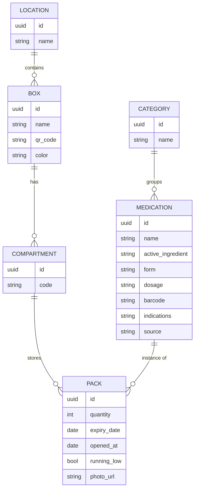

# Local Pharm

English | [Русский](README.ru.md)

A home medicine inventory app. Keeps track of what medications you have, where each one is stored, and when it expires.

Built as a Progressive Web App (PWA) with a shared database for two users.

## Overview

Medications at home tend to end up in one large box. When something is needed, it is often unclear whether it is available, finding it takes time, and expired or nearly empty packs go unnoticed.

Local Pharm solves this by providing:

- Fast search by brand name, active ingredient, category or symptom
- An exact storage location for every pack (e.g. Box 2, compartment B1)
- Adding medications by barcode, drug database lookup or manual entry
- Expiry date reminders
- An automatically generated shopping list

## Features

| Feature | Description |
|---|---|
| Search | By name, active ingredient, category or symptom |
| Location tracking | Every result shows where the pack is stored and its expiry date |
| Adding medications | Barcode scan, lookup in drug databases, manual entry as fallback |
| Boxes and cases | Shown in the app with their contents; a QR label on each box opens its page |
| Expiry tracking | Warning 30 days before expiry, separate list of expired items |
| Stock levels | Packs marked as running low are added to the shopping list |
| Shared access | Two users, one database, Google sign-in |
| Offline mode | Data is cached locally, search works without a connection |

## Data Model

The model has three layers: the **medication** (catalog entry), the **pack** (a physical package at home) and the **location** (where it is stored).



The same medication can exist as several packs in different locations, each with its own quantity and expiry date.

`MEDICATION.source` records where the entry came from: `local`, `amdm`, `openfda` or `manual`.

## Physical Storage

### Zones

| Zone | Contents |
|---|---|
| Quick-access kit | Most frequently used items: pain relief, fever reducers, plasters, antiseptic |
| Main storage | Everything else, organized by category |
| Travel case | Minimal set for trips |

### Categories

Each category gets its own box or compartment:

1. Pain and fever
2. Cold, throat and nose
3. Digestive
4. Allergy
5. Wound care and bandages
6. Blood pressure and heart
7. Vitamins and supplements
8. Children
9. Prescription and long-term treatment

### Labeling

- Each box has a number and a color; each compartment has a code (`A1`, `A2`, `B1`, ...).
- Each box has a QR label that opens its contents in the app.

## Medication Lookup

Medications come from many countries and are distributed by Moldovan importers, so no single API covers them all. Lookup runs in this order:

1. **Local database** – items added previously
2. **AMDM registry** – Moldovan national medicines register, imported into the local database
3. **openFDA / RxNorm** – international names and active ingredients
4. **Manual entry** – saved to the local database for future use

Free barcode APIs have poor coverage for medications. Barcodes are therefore stored the first time a product is added, so later scans resolve instantly from the local database.

## Tech Stack

| Layer | Technology |
|---|---|
| Frontend | Next.js, PWA (service worker, web app manifest) |
| Hosting | Vercel (`*.vercel.app` domain) |
| Database | Supabase (PostgreSQL) |
| Authentication | Supabase Auth with Google OAuth |
| File storage | Supabase Storage (pack photos) |
| Scanning | Browser camera with a barcode/QR reader library |
| Scheduled jobs | Vercel Cron |

## Security

- Sign-in with Google only.
- An allowlist of two email addresses; any other Google account is rejected.
- Row Level Security (RLS) in Supabase, so access is enforced at the database level, not only in the UI.
- Only basic scopes (name, email) are requested, so Google app verification is not required.

## Hosting Costs and Limitations

The project runs entirely on free tiers. Known limitations and how they are handled:

| Limitation | Mitigation |
|---|---|
| Supabase pauses free projects after 7 days of low activity | Daily Vercel Cron job that queries the database |
| Supabase Free has no automatic backups | JSON export in the app and a scheduled weekly export |
| Supabase limits: 500 MB database, 1 GB file storage | Compress pack photos; sufficient for a home inventory |
| Vercel Hobby is for personal, non-commercial use only | Matches this project's use case |
| Custom domains are paid | Use the free `vercel.app` subdomain |
| On iOS, push notifications require the PWA to be added to the home screen | Install to home screen; weekly email digest as a fallback |

## Roadmap

- [ ] **v0.1 Foundation** – database schema, Google sign-in, email allowlist, RLS
- [ ] **v0.2 Storage** – locations, boxes, compartments; manual medication entry
- [ ] **v0.3 Search** – by name, active ingredient and category; show storage location
- [ ] **v0.4 Lookup** – AMDM import, openFDA/RxNorm integration, barcode scanner
- [ ] **v0.5 QR labels** – generate and print box labels
- [ ] **v0.6 Expiry** – notifications, expired list, shopping list
- [ ] **v0.7 PWA** – offline mode, installation, push notifications
- [ ] **v1.0 Reliability** – keep-alive cron, backups, export and import

## Example

Searching for "fever" returns:

```
Paracetamol 500 mg
Quick-access kit, compartment A1
Expires 03/2027 · 8 tablets left
```

## License

Private project for personal use.
