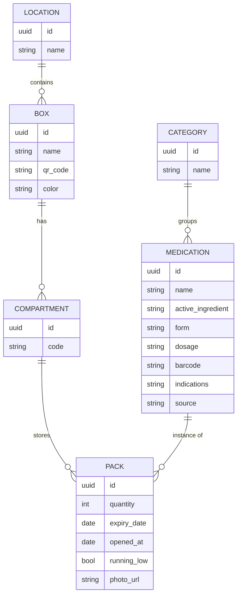

# Local Pharm

[English](README.md) | Русский

Домашний учёт лекарств. Хранит информацию о том, какие препараты есть, где лежит каждый из них и когда истекает срок годности.

Реализовано как Progressive Web App (PWA) с общей базой данных для двух пользователей.

## Обзор

Лекарства дома обычно оказываются в одной большой коробке. Когда что-то нужно, непонятно, есть ли оно, поиск занимает время, а просроченные или почти пустые упаковки остаются незамеченными.

Local Pharm решает это так:

- Быстрый поиск по названию, действующему веществу, категории или симптому
- Точное место хранения для каждой упаковки (например, коробка 2, отсек B1)
- Добавление препаратов по штрихкоду, через справочники лекарств или вручную
- Напоминания о сроках годности
- Автоматически формируемый список покупок

## Возможности

| Функция | Описание |
|---|---|
| Поиск | По названию, действующему веществу, категории или симптому |
| Местоположение | В каждом результате видно, где лежит упаковка и до какого числа она годна |
| Добавление препаратов | Скан штрихкода, поиск в справочниках, ручной ввод как запасной вариант |
| Коробки и кейсы | Отображаются в приложении с содержимым; QR-наклейка на коробке открывает её страницу |
| Сроки годности | Предупреждение за 30 дней, отдельный список просроченного |
| Остатки | Упаковки с пометкой «заканчивается» попадают в список покупок |
| Общий доступ | Два пользователя, одна база, вход через Google |
| Офлайн-режим | Данные кэшируются локально, поиск работает без интернета |

## Модель данных

Модель состоит из трёх уровней: **препарат** (запись в справочнике), **упаковка** (конкретная пачка дома) и **место** (где она хранится).



Один и тот же препарат может быть представлен несколькими упаковками в разных местах, у каждой своё количество и срок годности.

`MEDICATION.source` указывает, откуда взята запись: `local`, `amdm`, `openfda` или `manual`.

## Физическое хранение

### Зоны

| Зона | Содержимое |
|---|---|
| Аптечка быстрого доступа | Самое ходовое: обезболивающие, жаропонижающие, пластыри, антисептик |
| Основной склад | Всё остальное, разложенное по категориям |
| Дорожный кейс | Минимальный набор для поездок |

### Категории

Каждой категории отводится своя коробка или отсек:

1. Боль и температура
2. Простуда, горло и нос
3. Пищеварение
4. Аллергия
5. Раны и перевязка
6. Давление и сердце
7. Витамины и добавки
8. Детское
9. Рецептурные и курсовые препараты

### Маркировка

- У каждой коробки есть номер и цвет, у каждого отсека код (`A1`, `A2`, `B1`, ...).
- На каждой коробке QR-наклейка, которая открывает её содержимое в приложении.

## Поиск препаратов

Препараты произведены в разных странах и поставляются молдавскими импортёрами, поэтому ни один API не покрывает их все. Поиск выполняется в следующем порядке:

1. **Локальная база** – ранее добавленные препараты
2. **Реестр AMDM** – национальный реестр лекарств Молдовы, импортированный в локальную базу
3. **openFDA / RxNorm** – международные названия и действующие вещества
4. **Ручной ввод** – сохраняется в локальную базу для дальнейшего использования

Бесплатные API штрихкодов плохо знают лекарства. Поэтому штрихкод сохраняется при первом добавлении препарата, и последующие сканирования находят его сразу в локальной базе.

## Технологический стек

| Слой | Технология |
|---|---|
| Фронтенд | Next.js, PWA (service worker, web app manifest) |
| Хостинг | Vercel (домен `*.vercel.app`) |
| База данных | Supabase (PostgreSQL) |
| Аутентификация | Supabase Auth с Google OAuth |
| Хранение файлов | Supabase Storage (фото упаковок) |
| Сканирование | Камера браузера и библиотека чтения штрихкодов/QR |
| Фоновые задачи | Vercel Cron |

## Безопасность

- Вход только через Google.
- Белый список из двух email-адресов; любой другой аккаунт Google получает отказ.
- Row Level Security (RLS) в Supabase: доступ ограничен на уровне базы данных, а не только интерфейса.
- Запрашиваются только базовые данные (имя, email), поэтому проверка приложения в Google не требуется.

## Стоимость и ограничения хостинга

Проект полностью работает на бесплатных тарифах. Известные ограничения и способы их обойти:

| Ограничение | Решение |
|---|---|
| Supabase приостанавливает бесплатные проекты после 7 дней низкой активности | Ежедневная задача Vercel Cron, которая делает запрос к базе |
| На бесплатном тарифе Supabase нет автоматических резервных копий | Экспорт в JSON из приложения и еженедельная автоматическая выгрузка |
| Лимиты Supabase: 500 МБ база данных, 1 ГБ файлов | Сжатие фото упаковок; для домашней аптечки этого достаточно |
| Тариф Vercel Hobby только для личного некоммерческого использования | Соответствует назначению проекта |
| Собственный домен платный | Используется бесплатный поддомен `vercel.app` |
| На iOS push-уведомления работают, только если PWA добавлено на главный экран | Установка на главный экран; еженедельное письмо на email как запасной вариант |

## План разработки

- [ ] **v0.1 Основа** – схема БД, вход через Google, белый список email, RLS
- [ ] **v0.2 Хранение** – локации, коробки, отсеки; ручное добавление препаратов
- [ ] **v0.3 Поиск** – по названию, действующему веществу и категории; показ места хранения
- [ ] **v0.4 Справочники** – импорт AMDM, интеграция openFDA/RxNorm, сканер штрихкодов
- [ ] **v0.5 QR-наклейки** – генерация и печать наклеек для коробок
- [ ] **v0.6 Сроки годности** – уведомления, список просроченного, список покупок
- [ ] **v0.7 PWA** – офлайн-режим, установка, push-уведомления
- [ ] **v1.0 Надёжность** – keep-alive cron, резервные копии, экспорт и импорт

## Пример

Поиск по запросу «температура» возвращает:

```
Парацетамол 500 мг
Аптечка быстрого доступа, отсек A1
Годен до 03/2027 · осталось 8 таблеток
```

## Лицензия

Частный проект для личного использования.
